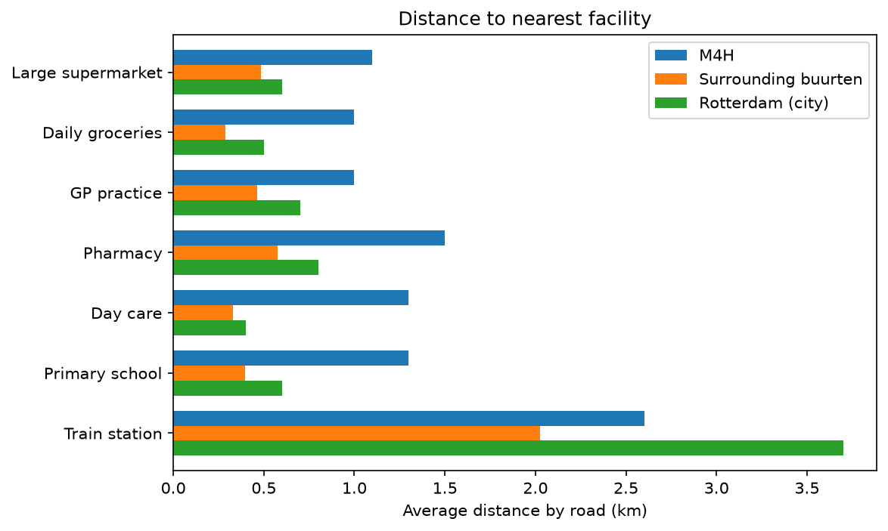
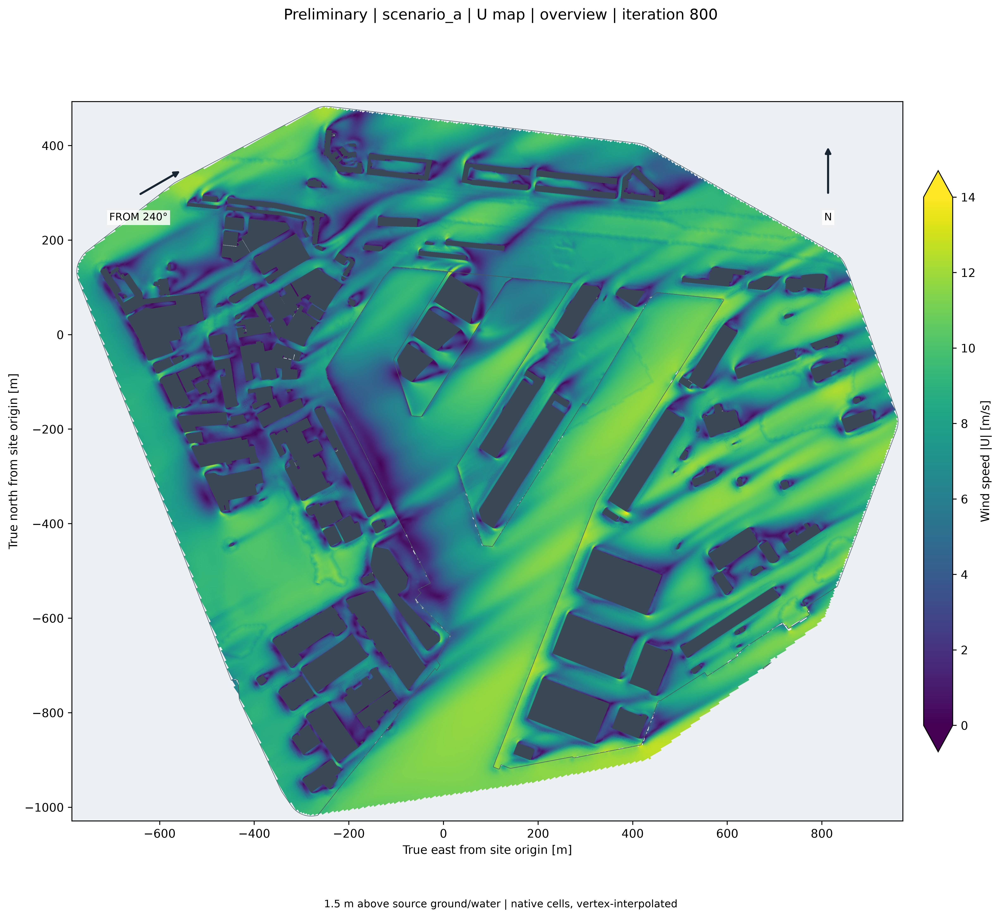
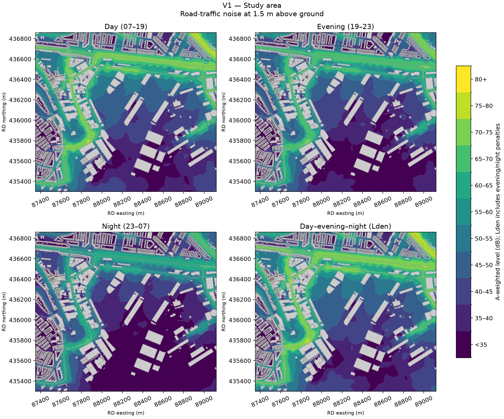
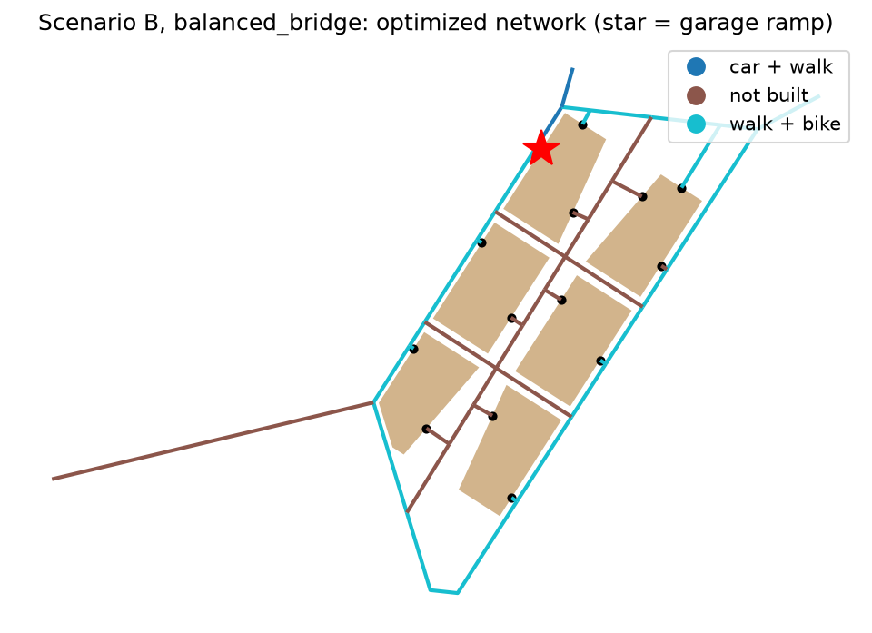
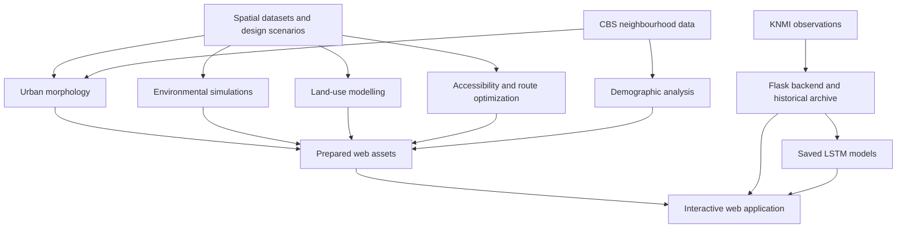

# MerweLab

MerweLab is a geospatial analysis and visualization project focused on redevelopment scenarios in **Merwehaven, Rotterdam**.

Developed for the Geo-Spatial Studio, it combines urban design, morphological indicators, environmental simulations, demographic analysis, machine learning, and accessibility planning. An interactive Cesium application brings these results together so users can explore the study area and compare design proposals.

## Design scenarios

| Scenario | Identifier | Description |
|---|---|---|
| Existing situation | `baseline` | Existing buildings and site conditions |
| V1 | `scenario_a` | Proposal with three larger building volumes |
| V2 | `scenario_b` | Proposal with smaller buildings around a central road |

## Project components

### Geospatial data integration

The spatial environment combines:

- Aerial imagery
- AHN ground elevation and elevation colours
- Existing and proposed 3D building models
- Regional building context
- Vegetation models
- Water and site surfaces
- Study boundaries and analytical grids

These datasets provide the geographical context for the analyses and support both perspective and top-down exploration.

### Urban morphological indicators

The morphology workflow examines how building form and spatial configuration influence environmental conditions in V1 and V2.

It includes the following indicators and supporting maps:

| Group | Indicators and outputs |
|---|---|
| Building height | Extended building-height classes |
| Building density | Extended density classes |
| Height-to-width ratio | Dominant H/W classes on a 50 m grid and H/W classes for 25 m open spaces |
| Sky View Factor | Classified and continuous SVF maps |
| Morphological risk | Combined heat and ventilation risk, with priority areas |
| Vulnerability-adjusted risk | Risk and priority maps incorporating neighbourhood vulnerability |
| Change analysis | Priority changes after vulnerability adjustment and SVF changes relative to the existing situation |
| Supporting context | Neighbourhood age 45+ share, scenario introduction maps, and a universal 50 × 50 m analytical grid |

The analysis notebook is located at:

```text
analysis/morphology/urban_factors.ipynb
```

Exported indicator rasters and metadata are stored under:

```text
outputs/data/morphology/extended/
```

In the application, users can overlay multiple indicators, adjust each layer's opacity, inspect legends, and compare the proposals.

### Integration of KNMI sensor data

The weather component combines historical monitoring, ongoing observations, and AI-based predictions.

Observations come from the **Rotterdam Airport KNMI station** at ten-minute intervals and include:

- Air temperature
- Relative humidity
- Air pressure
- Mean wind speed
- Maximum wind speed

The Flask backend maintains a persistent historical archive and periodically retrieves newer observations. The Weather view displays the available history with selectable sensor series and time scales.

#### AI prediction models

The repository includes a TensorFlow/Keras modelling workflow with:

- Data loading and preprocessing
- Feature scaling
- Time-sequence construction
- LSTM model training
- Hyperparameter tuning
- Model evaluation and plotting
- Saved model files and training scalers

The saved models used by the backend predict **temperature 10, 30, and 60 minutes ahead**. They use the latest 18 consecutive ten-minute observations of temperature, humidity, and pressure.

The backend applies the saved training scalers before inference and converts predictions back into degrees Celsius. The dashboard displays the forecasts and their documented test RMSE values.

The modelling code and saved models are located under:

```text
analysis/sensor/
```

### Land-use analysis and modelling

The land-use workflow simplifies the source classification into six categories:

| Value | Class |
|---|---|
| 0 | Other |
| 1 | Traffic |
| 2 | Residential |
| 3 | Public facility |
| 4 | Green space |
| 5 | Water |

A neural Q-value model evaluates possible land-use assignments using neighbourhood composition and proximity features.

Its training and constraint logic account for factors such as:

- Residential and green-space shares
- Public-facility provision and clustering
- Access to traffic infrastructure
- Proximity of housing to greenery and facilities
- Proximity of greenery to water
- Spatial continuity and fragmented land-use patches

The workflow includes model training, reward evaluation, constrained map generation, and export of the proposed land-use raster.

Code and datasets are located under:

```text
analysis/land_use/
data/land_use/
```

The application displays the existing classification, the shared optimized proposal, and a changes overlay. Users can adjust layer opacity, inspect classes by clicking the map, and view class coverage.

### CBS neighbourhood analysis

CBS data adds demographic and social context to the study.

The analysis includes neighbourhood characteristics such as age distribution, households, housing, car ownership, and distance to facilities.

Neighbourhood boundaries are interactive in the application: clicking a neighbourhood reveals its available information.



### Wind analysis

Wind simulations examine the relationship between urban form and airflow.

The results include wind speed, turbulence, pressure, velocity arrows, and streamlines for the existing situation and design proposals.



### Noise analysis

NoiseModelling results describe spatial noise exposure for the existing situation, V1, and V2.

The application supports day, evening, night, and day–evening–night maps, with interactive noise-threshold filtering.



### Accessibility and route optimization

The network analysis explores accessibility and alternative routes for the proposed development.

It includes walking and cycling connections, building entrances, designated garage access, and saved alternatives with different priorities:

- Balanced
- Access first
- Green first
- No wind

The application displays network geometry, alternative settings, accessibility information, and comparison results.



## Web application

The application provides three main views.

### Explore

Explore the existing situation, V1, and V2 through interactive layers.

Use the left panel to select datasets and the right panel to adjust settings and inspect results. Supported layers provide information when clicked.

The **2D/3D** controls switch between a top-down view with building outlines and a perspective view with 3D buildings.

### Compare

Display two scenarios side by side with synchronized cameras.

Compare urban morphology, environmental results, land-use layers, and network alternatives at the same location.

### Weather

Explore historical KNMI observations and short-term temperature predictions.

The dashboard supports sensor-series toggles, different time scales, historical navigation, connection status, and progressive updates while the backend downloads observations.

## Repository structure

```text
MerweLab/
├── analysis/               # Analysis workflows, notebooks, and trained models
│   ├── cbs/
│   ├── land_use/
│   ├── morphology/
│   ├── network/
│   ├── noise/
│   ├── sensor/
│   └── wind/
├── app/
│   ├── backend/            # Flask weather API and synchronization service
│   └── frontend/           # React, TypeScript, Vite, and Cesium application
├── config/                 # Shared scenario and asset configuration
├── data/                   # Source datasets and processed inputs
│   └── web/                # Prepared assets consumed by the frontend
├── outputs/
│   ├── data/               # Exported analysis and simulation results
│   └── figures/            # Generated maps and plots
├── scripts/
│   └── web/                # Preparation of browser-ready datasets
└── tools/                  # Supporting conversion utilities
```



## Requirements

To run the web application locally:

- Git and Git LFS
- **Node.js 22.12 or newer**
- **Python 3.12 or newer**
- **uv** for Python dependency management
- A browser with WebGL enabled
- Internet access for online imagery and KNMI updates
- A KNMI **EDR API token** for downloading weather observations (you can get your own token here: https://developer.dataplatform.knmi.nl/edr-api)

The frontend and backend have separate dependencies. The commands below can be used on Windows and Linux.

## First-time setup

### 1. Clone the repository

```bash
git clone https://github.com/SimeonVutov/MerweLab.git
cd MerweLab
```

Retrieve files managed through Git LFS:

```bash
git lfs install
git lfs pull
```

### 2. Configure KNMI access

Create a `.env` file in the **repository root**:

```dotenv
EDR_API_TOKEN=your_knmi_edr_api_token
```

Use a token for the KNMI EDR API. Keep this file local and do not commit it.

Without a token, the backend can serve an existing historical archive, but it cannot download observations.

### 3. Install backend dependencies

From the repository root:

```bash
cd app/backend
uv sync
```

### 4. Install frontend dependencies

In another terminal, from the repository root:

```bash
cd app/frontend
npm ci
```

Prepared spatial assets are included in the repository. Running the application does not require retraining the models or rerunning the analyses and simulations.

## Starting the application

Run the backend and frontend in **two separate terminals**.

### Backend

From the repository root:

```bash
cd app/backend
uv run python server.py
```

The backend runs at:

```text
http://127.0.0.1:5000
```

Check that it is running by opening:

```text
http://127.0.0.1:5000/api/health
```

Starting `server.py` also starts the background weather updater.

### Frontend

From the repository root, in a second terminal:

```bash
cd app/frontend
npm run dev
```

Open the address printed by Vite, normally:

```text
http://127.0.0.1:5173
```

The frontend forwards API requests to the backend on port `5000`.

To use a different frontend port:

```bash
npm run dev -- --port 5174
```

Stop either server with `Ctrl+C` in its terminal.

## Weather storage and updates

The backend stores observations in:

```text
app/backend/data/weather/rotterdam_airport_weather.csv
```

On startup, it reads the archive and requests observations newer than the latest stored timestamp. Existing observations are preserved, so restarting the server does not require downloading the entire history again.

If no archive exists, the backend progressively downloads observations from the start date configured in:

```text
app/backend/weather_settings.py
```

The current default is **1 January 2024**.

The backend checks KNMI every ten minutes. The frontend initially loads the available archive, then requests incremental updates once per minute. During active synchronization, it checks more frequently to display newly stored historical batches.

The available date range is determined from the data. Incoming observations update the dashboard without changing the user's selected historical view.

## Technologies

| Area | Technologies |
|---|---|
| Interactive mapping | CesiumJS |
| Frontend | React, TypeScript, Vite |
| Backend | Python, Flask |
| Weather prediction | TensorFlow/Keras LSTM models |
| Land-use modelling | DQN model with spatial constraints |
| Geospatial workflows | Raster and vector processing, notebooks, and preparation scripts |
| Observations and context | KNMI, CBS, AHN, aerial imagery, building and vegetation datasets |
