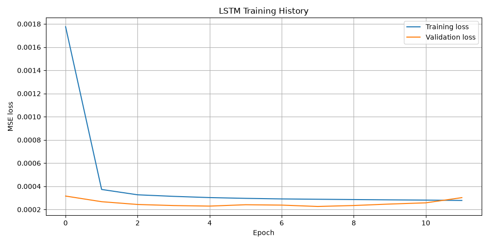
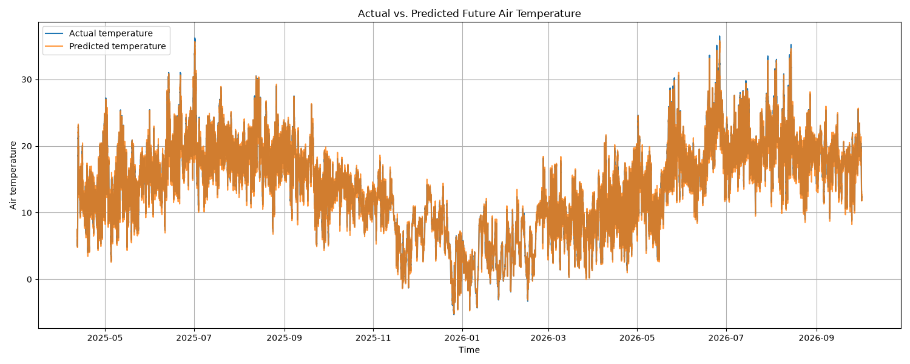

from IPython.core.completerlib import import_re

# Structure 

Sensor assignment consists of two parts.
First the historical data has to be fetched from KNMI and saved.
Then, based on the historical data the LSTM model is created and saved.

## Data Fetching

In order to fetch data, first you need to paste your authentication token into a proper field in `edr_api.py`.
Then specify the date range you want to get, and the file. 

### How it works?

We're using EDR API to fetch data from only one sensor. The dataset used contains readings from every 10 minutes.
Thanks to that we don't need to get files with multiple readings, we just need a sensor id to get all the measurements.

It is not possible to fetch large data simultaneously. Therefore, the data is fetched monthly, and then merged into one huge dataframe.

### What data we gather?

We used _10-minute-in-situ-meteorological-observations_, so there are observations from every 10 minutes.
Main features we store are:
- Mean temperature throughout 10 minutes
- Humidity
- Air Pressure
For the historical data, we get readings from 1st of January 2012 to 1st of October 2026. This is 39,5 MB of raw data.

### Sensor used

We're using the sensor located in Rotterdam Airport

- Sensor name: "Rotterdam Airport"
- Sensor id: "0-20000-0-06344"

## Modelling

In order to model the data, first you need to specify the parameters in the `config.py`. Then just run `main.py`.
You'll get your new model and a scaler.

# Results

For forecast horizon = 6 (1 hour)

| ID  | Neurons in LSTM | Neurons in Dense | Dropout Rate | Batch Size | Epochs | Patience | Input Sequence Length | Val RMSE | Test RMSE |
|-----|-----------------|------------------|--------------|------------|--------|----------|-----------------------|----------|-----------|
| 1_1 | 200             | 100              | 0.25         | 512        | 30     | 4        | 18                    | 0.804687 | 0.877858  |
| 1_2 | 150             | 125              | 0.25         | 512        | 30     | 4        | 18                    |          |           |
| 1_3 | 150             | 125              | 0.25         | 256        | 30     | 4        | 18                    |          |           |

## Plots

### 1_1 Plots




# Reusing the model

To reuse the model run to load the model.
```python
import tensorflow as tf

tf.keras.models.load_model("<Path to the model>")
```

Then you have to scale the data using the scaler used for training
```python
from preprocessing import MyScaler

MyScaler.load("<Path to the scaler>")
```
This part can be changed so instead of using MyScaler we could use some existing MinMaxScaler with built-in save/